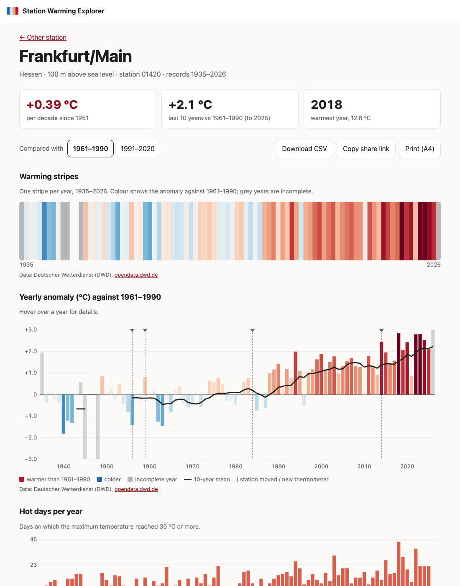
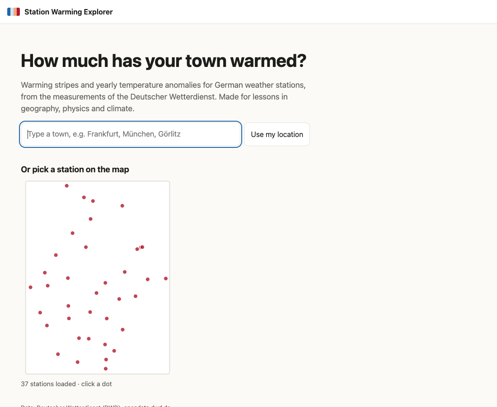

# Station Warming Explorer

Warming stripes and yearly temperature anomaly charts for German weather stations, built from the
German Weather Service's (DWD) free open data. Made for school teachers who want to show students
how **their own town** has warmed, using real local measurements instead of global averages.

A Python pipeline parses DWD's raw zipped files into PostgreSQL, FastAPI serves compact yearly
figures, and React draws them. A 70-year station has about 25,000 daily rows; the browser receives
about 70 yearly points (under 10 KB, about 1.6 KB gzipped).



| Home: search, "use my location", map | Print view (one A4 page) |
| --- | --- |
|  | [docs/print-example-frankfurt.pdf](docs/print-example-frankfurt.pdf) |

## Features

- **Station search** with debounced, umlaut-insensitive lookup (`munchen`, `muenchen` and
  `München` all match), **use my location** (nearest stations by haversine distance) and a small
  dot map of all loaded stations.
- **Warming stripes**: one SVG `<rect>` per year on a blue–white–red scale; incomplete years grey.
- **Anomaly bars** above/below zero against 1961–1990 (or 1991–2020), with a **10-year rolling mean**
  line, hover details (year, mean, anomaly, valid days) and markers for **station moves and
  thermometer changes** read from DWD's metadata files.
- **Trend headline**, e.g. "+0.39 °C per decade since 1951", plus last-10-years anomaly and warmest year.
- **Teacher extras**: CSV download, share links like `/station/01420`, a print stylesheet that fits
  one A4 page, and a plain-English (and German) explanation of what an anomaly is.
- "Data: Deutscher Wetterdienst (DWD)" attribution on every chart.
- Stretch features: **hot days** per year (TXK ≥ 30 °C) and a **nightly refresh** of DWD `recent/` data.

## Architecture

```
DWD open-data server → Python ingest → PostgreSQL daily_temp → SQL yearly_temp (materialized view)
                     → FastAPI JSON (~70 points) → React charts (served by nginx)
```

| Component  | Runs as                          | Job |
| ---------- | -------------------------------- | --- |
| Ingest CLI | Python 3.12 (Docker or local)    | Downloads station list and zipped daily files, parses them, loads PostgreSQL |
| PostgreSQL | `postgres:16` container          | `stations`, `daily_temp`, `station_events`, `yearly_temp` view |
| API        | FastAPI + Uvicorn                | Station search and compact yearly series with anomalies |
| Web        | React (Vite, TypeScript) + nginx | Search, stripes, anomaly chart, CSV download |

## Quick start (Docker)

```bash
cp .env.example .env          # set POSTGRES_PASSWORD; change host ports if they are taken
docker compose up -d --build  # postgres, api (:8000), web (:8080)
```

Load data (station list first, then stations):

```bash
docker compose run --rm ingest python -m swe_ingest.cli stations          # ~1,400 stations
docker compose run --rm ingest python -m swe_ingest.cli starter           # 36 long-record stations
docker compose run --rm ingest python -m swe_ingest.cli station 00433     # one station
docker compose run --rm ingest python -m swe_ingest.cli all --state Hessen --active-since 2020
```

Open <http://localhost:8080>. Interactive API docs (Swagger) come free with FastAPI at
<http://localhost:8000/docs> (also proxied at <http://localhost:8080/docs>).

Nightly refresh of DWD `recent/` data (runs at 04:30 container time):

```bash
docker compose --profile cron up -d cron
```

All ingest commands are idempotent: they `COPY` into a temp table and upsert, so re-running is safe.
Downloads happen one at a time with a short pause (`--pause`, default 1 s) to be polite to DWD.

## API

| Method and path | Returns |
| --- | --- |
| `GET /api/stations?q=frank&limit=10` | Matching loaded stations: id, name, state, lat, lon, first and last year |
| `GET /api/stations/near?lat=50.1&lon=8.7&limit=5` | Nearest loaded stations with `distance_km` (haversine in SQL) |
| `GET /api/stations/{id}` | Station details plus metadata notes (moves, thermometer changes) |
| `GET /api/stations/{id}/yearly?ref=1961-1990&min_days=330` | `{year, mean_c, anomaly_c, valid_days, complete, rolling_anomaly_c, hot_days}` per year, plus reference mean and linear trend in °C per decade |
| `GET /api/stations/{id}/yearly.csv` | Same data as CSV for teachers |
| `GET /api/health` | Status for Docker |

Data endpoints send `Cache-Control: public, max-age=86400` (DWD data changes at most once a day)
and are gzip-compressed.

## How the numbers are calculated

1. **Daily values.** From each DWD `produkt_klima_tag_*.txt` we keep `MESS_DATUM`, `TMK` (daily
   mean air temperature), `TXK` (daily maximum) and `QN_4` (quality level). DWD writes `-999` for
   missing values; these become `NULL` before any maths, so they never enter a mean.
2. **Historical vs recent.** `historical/` is quality-controlled, `recent/` covers roughly the
   last 500 days. Where they overlap, the historical value wins; recent days are only added after
   the historical end date. The upsert enforces this, so the nightly refresh can never overwrite
   a historical value.
3. **Yearly mean.** SQL first averages the valid daily means of each month, then averages the
   monthly means (`yearly_temp`). This is DWD's own convention for annual values; averaging all
   days instead gives the short, cold February less weight and comes out ~0.04 °C too warm.
4. **Completeness rule.** A year counts only if it has **at least 330 valid days and every month has
   at least 20 valid days**. A month with no data at all counts as 0. Otherwise the year is marked
   incomplete and shown grey, because a year with a missing winter would look too warm.
5. **Reference mean.** The mean of the complete years in the reference period (default 1961–1990).
   At least 25 of the 30 years must be complete; otherwise `anomaly_c` is `null` and the API
   returns a message suggesting 1991–2020.
6. **Anomaly** = yearly mean − reference mean.
7. **10-year rolling mean**: trailing mean of the complete years in the last 10 years (needs at
   least 8 of them).
8. **Trend**: ordinary least-squares slope through the complete years from 1951 on (or from the
   first year, for younger stations), × 10 for °C per decade.
9. **Hot days**: days with `TXK ≥ 30 °C`, only shown for years whose `TXK` is complete enough.

### Verified against DWD's own published figures

Checked for all 37 loaded stations against DWD's annual values (`climate/annual/kl`, column
`JA_TT`) and multi-annual normals (`climate/multi_annual`):

- **Yearly means:** 3,163 of 3,164 station-years match DWD's annual mean within 0.05 °C (nearly
  all within 0.01 °C, i.e. rounding).
- **Hot days:** the 1961–1990 and 1991–2020 averages match DWD's `Heissetage` normals for almost
  every station.
- **30-year normals:** stations whose DWD normal is *not* homogenised (List auf Sylt, München-Stadt,
  Stötten) match within 0.04 °C. Most DWD normals are *homogenised* (data source 51): DWD adjusts
  older readings to the station's current location. This app shows the raw measurements, so those
  normals differ by typically 0.1–0.3 °C, most for stations with many moves (Freiburg: 0.7 °C,
  six moves). Moves are shown as markers on the chart for this reason.
- Stations without a 1961–1990 reference (Konstanz, Leipzig/Halle, Kiel, Meiningen,
  Münster/Osnabrück) genuinely lack daily data for that period in DWD's files.

## Local development

Requires Python 3.12 (e.g. via `uv`), Node 20+ and Docker for PostgreSQL.

```bash
docker compose up -d postgres
cd ingest && uv venv -p 3.12 .venv && uv pip install -p .venv -e '.[dev]'
DATABASE_URL=postgresql://postgres:<pw>@localhost:5432/climate .venv/bin/python -m swe_ingest.cli stations
# existing database from before the monthly-mean change? run db/migrations_001_monthly_mean.sql once

cd api && uv venv -p 3.12 .venv && uv pip install -p .venv -e '.[dev]'
DATABASE_URL=... .venv/bin/uvicorn app.main:app --reload

cd web && npm install && npm run dev   # http://localhost:5180, proxies /api to :8000
```

## Tests

```bash
export TEST_DATABASE_URL=postgresql://postgres:<pw>@localhost:5432/postgres   # admin DSN
(cd ingest && .venv/bin/pytest)   # parsers on real DWD fixture files + loader against PostgreSQL
(cd api && .venv/bin/pytest)      # climate maths + every endpoint against a throwaway database
(cd web && npm test)              # stripes, bars, hover, debounced search, station page
```

Database tests create and drop their own databases (`swe_test`, `swe_api_test`) and are skipped
if PostgreSQL is unreachable. Fixtures in `ingest/tests/fixtures/` are cut from real DWD files:
a station list excerpt (Latin-1, with umlauts) and Hohenpeißenberg 1944–1946, which contains
real `-999` days in May 1945.

### Testing checklist

- [x] A station name with umlauts (Baden-Württemberg, Hohenpeißenberg) is stored and displayed correctly.
- [x] A day with `-999` becomes `NULL` and is not counted in the yearly mean.
- [x] A year with a missing month is marked incomplete and greyed out.
- [x] The mean anomaly over 1961–1990 is close to 0.0 °C.
- [x] Re-running ingest for the same station changes no row counts (verified on 1.17 M real rows).
- [x] `/yearly` for a 70-year station returns about 70 items and stays under 10 KB.
- [x] Numbers match DWD's own published annual means (all 37 stations, see above).

## Repository layout

```
├── docker-compose.yml        postgres, api, web; ingest (profile tools) and cron (profile cron)
├── .env.example              POSTGRES_PASSWORD, DATABASE_URL, host ports
├── db/schema.sql             tables + yearly_temp materialized view
├── ingest/swe_ingest/
│   ├── cli.py                typer commands: stations, station, all, starter, refresh-recent
│   ├── dwd.py                folder listing, polite download with retries
│   ├── parse.py              station list (fixed-width, Latin-1), produkt files, metadata
│   └── load.py               COPY + idempotent upsert, view refresh
├── api/app/
│   ├── main.py               FastAPI endpoints
│   ├── db.py                 psycopg connection pool
│   ├── models.py             Pydantic schemas
│   └── climate.py            completeness, anomaly, rolling mean, trend
└── web/src/
    ├── pages/{HomePage,StationPage}.tsx
    └── components/{Stripes,AnomalyBars,HotDays,StationSearch,StationMap,Explainer}.tsx
```

## Data and attribution

Data: Deutscher Wetterdienst (DWD), Climate Data Center,
<https://opendata.dwd.de/climate_environment/CDC/observations_germany/climate/daily/kl/>.
Check DWD's current open-data terms before publishing a deployment.
